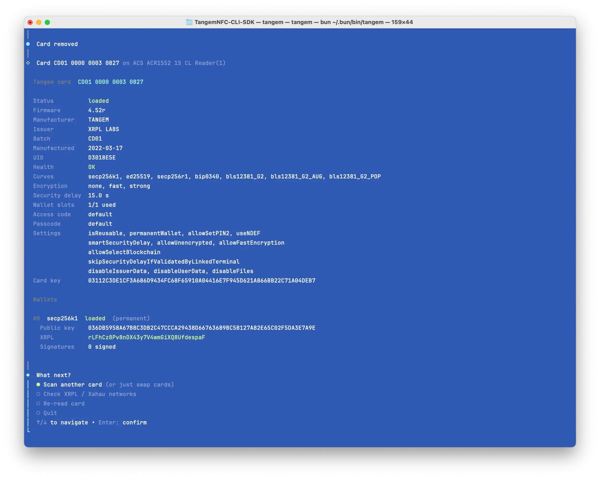

# tangem-nfc

Talk to [Tangem](https://tangem.com) NFC cards from your computer with a USB PC/SC reader: a small TypeScript SDK and a `tangem` CLI.



- **No native addons.** Calls the OS smart card stack directly through `bun:ffi` (macOS `PCSC.framework`, Linux `libpcsclite`, Windows `winscard.dll`), so nothing needs compiling and nothing breaks on new Node versions.
- **Works with all three encryption modes:** plain, fast (challenge/response) and strong (ECDH secp256k1). The protocol is upgraded automatically when a card answers `SW_NEED_ENCRYPTION`.
- Handles **security delays** (`SW_NEED_PAUSE`), access codes, passcodes and CVC. When the card already reports a custom code, `tangem` asks for it before sending anything, because every wrong code slows the card down.
- Works with both legacy single-wallet cards (fw < 4) and multi-wallet / HD cards (fw ≥ 4).
- **XRPL addresses** for secp256k1 and ed25519 wallets, including on-card BIP44 derivation (`m/44'/144'/0'/0/0`, or any paths you pass) for HD wallets.
- Optional **account lookups** on XRPL and Xahau, mainnet and testnet.

## Requirements

- [Bun](https://bun.sh) ≥ 1.1
- A compatible PC/SC contactless reader (see below)
- Linux: `pcscd`, `libpcsclite1` and the CCID driver (`sudo apt install pcscd libpcsclite1 libccid`)

### Reader compatibility

Tangem cards are ISO 14443-4 Type A, and their responses are often longer than a short APDU allows. A reader must have:

- **A PC/SC driver.** USB CCID readers work with the built-in driver on macOS, `libccid` on Linux, and the inbox or vendor driver on Windows.
- **ISO 14443-4 (T=CL) support** for Type A cards.
- **Extended-length APDUs / responses longer than 256 bytes.** The Tangem spec allows up to 1 KB per command or response. A full `READ` from a firmware 3.x Tangem Note is 377 bytes, which is more than the 258 bytes (256 data + 2 status) a short-APDU-only reader can return. `tangem` sends short APDUs whenever the data fits and only switches to extended length above 255 bytes, but long responses still have to come back in one piece.

Readers that only support short APDUs, which includes many older PN53x-based readers such as the ACR122U, usually fail on these long responses. The typical symptom is `SCardTransmit failed: SCARD_E_NOT_TRANSACTED` or a truncated response. Use `-v` to see the raw exchange.

| Reader | Status |
| --- | --- |
| ACS ACR1552U | ✅ tested: plain, fast and strong encryption, security delay, card removal detection |

Some readers show up as more than one PC/SC slot (the ACR1552U appears as `Reader(1)` and `Reader(2)`). By default `tangem` uses whichever slot has a card. Pick one with `-r <index|name>`, and see `tangem readers` for the list.

## Install

```bash
git clone https://github.com/WietseWind/Tangem-NFC-CLI-Utility && cd Tangem-NFC-CLI-Utility
bun install
bun link            # puts `tangem` in ~/.bun/bin
```

## CLI

```bash
tangem                       # interactive wizard: scan → info → check / create / delete …; swap cards to scan the next one
tangem info                  # card + wallets + XRPL addresses
tangem info --check          # …and look the addresses up on XRPL/Xahau main + testnet
tangem create -c secp256k1   # create a wallet (prompts for the curve if omitted)
tangem delete -i 0           # purge wallet #0 (asks for confirmation; -y to skip)
tangem address -n mainnet    # XRPL addresses, checked on XRPL + Xahau mainnet
tangem address --path "m/44'/144'/0'/0/0,m/44'/144'/1'/0/0"   # HD: several derived accounts
tangem address --address rXXX… -n xrpl   # check just this address
tangem readers               # list readers
tangem info --json           # machine readable output
```

Every value can be passed as a flag. If a value is missing and you're in a terminal, `tangem` asks for it. With `--json`, `--no-input`, or when stdin/stdout aren't a TTY, it never prompts and exits with an error if something it needs is missing.

| Option | |
| --- | --- |
| `-r, --reader <name\|index>` | Reader to use. By default `tangem` waits for a card on any reader. |
| `-a, --access-code <code>` | Access code / PIN1 (default `000000`). Prompted for if the card rejects it. |
| `-p, --passcode <code>` | Passcode / PIN2 (default `000`). Prompted for if the card rejects it. |
| `--cvc <code>` | The 3-digit CVC printed on the card. Only cards personalized with `UseCVC` need it, for create and delete; you're prompted if it's missing. |
| `-e, --encryption <mode>` | `auto` (default), `none`, `fast` or `strong` |
| `-c, --curve <curve>` | `secp256k1`, `ed25519`, `ed25519_slip0010`, `secp256r1`, `bip0340`, `bls12381_G2*` |
| `-i, --index <n>` | Wallet slot |
| `--path <path,…>` | HD path(s) used for XRPL addresses, comma separated or repeated (default `m/44'/144'/0'/0/0`) |
| `--address <r…,…>` | Only show and check these r-addresses |
| `--check`, `-n, --networks <list>` | Look up accounts on `all`, `mainnet`, `testnet`, `xrpl`, `xrpl-testnet`, `xahau`, `xahau-testnet` |
| `-y, --yes` | Skip the delete confirmation |
| `--force` | Delete: skip the client-side permanent-wallet check and let the card decide |
| `-t, --timeout <s>` | Give up waiting for a card after this many seconds |
| `-v, --verbose` | Trace APDUs (in plain text) to stderr |

### Which XRPL addresses?

`tangem` never picks just one; it lists every address the card can produce:

| Wallet | Addresses |
| --- | --- |
| secp256k1 | the address from the wallet's own key |
| ed25519 / ed25519_slip0010 | the address from the wallet's own key (`ED…` public key) |
| HD secp256k1 (has a chain code, fw ≥ 4.39) | the address from the wallet's own key **plus** one derived on the card for each `--path`. The Tangem app uses `m/44'/144'/0'/0/0`. |
| secp256r1, bip0340, BLS | none (not usable on XRPL) |

Multi-wallet cards list every wallet. In the wizard, **Check XRPL / Xahau networks** lets you pick which addresses and which networks to check (everything is ticked by default). Passing `--address` or `-n` skips that question.

Network lookups use `xrplcluster.com`, `testnet.xrpl-labs.com`, `xahau.network` and `xahau-test.net`.

## SDK

```ts
import { Tangem, xrplAddress } from 'tangem-nfc'

const tangem = await Tangem.connect({ accessCode: '000000' }) // waits for a card
try {
  const card = await tangem.scan()           // READ + wallet list
  console.log(card.cardId, `${card.firmware}`, card.supportedCurves)

  if (!card.wallets.length && !tangem.createBlocker('secp256k1')) {
    const wallet = await tangem.createWallet({ curve: 'secp256k1' })
    console.log(xrplAddress(wallet.publicKey, 'secp256k1'))
  }

  // HD wallets: derive on-card
  const derived = await tangem.readWallet(0, "m/44'/144'/0'/0/0")
} finally {
  tangem.close()
}
```

Lower-level building blocks are exported as well: `Pcsc` / `CardConnection` (raw APDUs), `Session` (framing, encryption, security delay), `Tlv`, `parseCard`, `crc16a`, plus the protocol constants (`INS`, `TAG`, `SW`, …).

## Layout

```
src/pcsc.ts       PC/SC over bun:ffi (per-platform ABI)
src/session.ts    APDU framing, OPEN_SESSION, AES-256-CBC, CRC-A, security delay
src/tlv.ts        Tangem SimpleTLV
src/card.ts       READ / wallet deserialization, firmware versions
src/tangem.ts     High level API: scan, readWallet, createWallet, purgeWallet
src/xrpl.ts       XRPL address encoding
src/networks.ts   XRPL / Xahau account lookups
src/cli/          `tangem` CLI
```

## Protocol notes

- Commands are ISO 7816-4 APDUs `00 INS P1 P2 Lc data`; P1 selects the encryption mode (`00` none, `01` fast, `02` strong).
- Encrypted payloads are `AES-256-CBC(session_key, len(2) | CRC-A(2) | TLV)` with a zero IV, where `session_key = SHA256(secret | PBKDF2-SHA256(SHA256(PIN1), UID, 50))`.
- Firmware ≥ 8.59 uses a new CCM-based secure channel. These cards can be read (`READ` mode 1 is always unencrypted), but wallet commands are not implemented yet.

## Disclaimer

Deleting a wallet destroys its private key forever, and any funds still on it are lost. Use at your own risk. This project is not affiliated with Tangem AG.

## License

MIT
